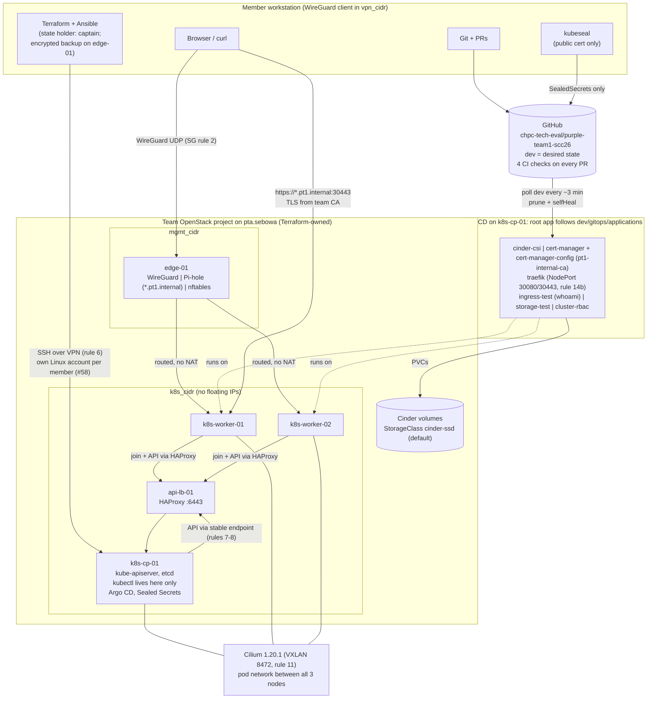

# Week-2 architecture: Kubernetes + GitOps

Editable source: [`cluster-gitops.mmd`](cluster-gitops.mmd) (Mermaid). The block below is a copy of it so GitHub renders it inline; edit the `.mmd` file first, then copy it here. The Week-1 network and trust boundaries are unchanged: [`../../week1/diagrams/`](../../week1/diagrams/README.md).

**Address-free (instructor rule on #23):** only variable names (`mgmt_cidr`, `k8s_cidr`, `vpn_cidr`) and SG rule numbers from [`docs/network-design.md`](../../../docs/network-design.md) §4 appear.

**How to read it:** members change the cluster through **Git**, not `kubectl`. A PR merged into `dev` is picked up by Argo CD on `k8s-cp-01` and applied to the workers. Terraform and Ansible (host layer) run from the workstation over the VPN. `kubectl` runs only on `k8s-cp-01`, under each member's own account and kubeconfig (#58). Users reach apps over the VPN on the Traefik NodePorts, with TLS from the team CA.

| Layer | Owner | Where it is defined |
| --- | --- | --- |
| VMs, networks, security groups | Terraform | `infrastructure/terraform` |
| OS, containerd, kubeadm, Cilium/Argo/Sealed-Secrets bootstrap, member accounts | Ansible | `infrastructure/ansible` |
| Everything long-lived inside Kubernetes | Argo CD | `gitops/applications` + `gitops/resources` |
