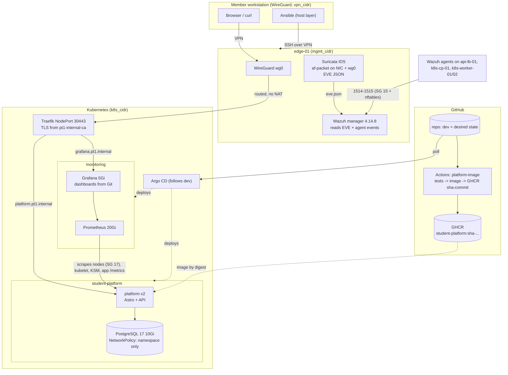

# Week-3 architecture: observability, security telemetry, Student Platform

Editable source: [`observability-security.mmd`](observability-security.mmd) (Mermaid). The block below is a copy of it so GitHub renders it inline; edit the `.mmd` file first, then copy it here. Week-1 network and Week-2 cluster: [`../../week1/diagrams/`](../../week1/diagrams/README.md), [`../../week2/diagrams/`](../../week2/diagrams/README.md).

**Address-free:** only variable names and SG rule numbers from [`docs/network-design.md`](../../../docs/network-design.md) §4.

**The three observability questions (week3):** Prometheus/Grafana answers *is the platform healthy?*, Wazuh answers *what host/security events happened?*, Suricata answers *what did the network IDS see?*

| Path | Ports / rule |
| --- | --- |
| Prometheus → node-exporter on every node | 9100/tcp, SG row 17 (`k8s_cidr`) |
| Wazuh agents → manager on edge-01 | 1514-1515/tcp, SG row 15 + edge nftables (private ranges) |
| Browser → Grafana / Platform | VPN → worker NodePort 30443 (rule 14b) → Traefik, team-CA TLS |
| Platform → PostgreSQL | 5432 inside `student-platform` only (NetworkPolicy) |
