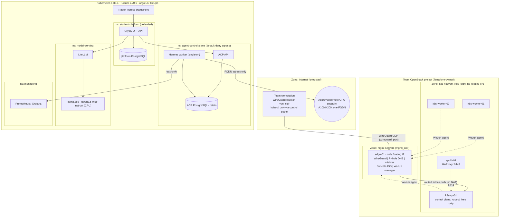

# Paper figure provenance

Every final figure should be reproducible or traceable.

For each figure, retain:

- source script/notebook/tool or original editable diagram;
- input data/log/result file;
- generation date and relevant Git SHA;
- units and axis labels;
- explanation of any filtering/aggregation;
- no secrets, tokens, private IP/address details or other unnecessary sensitive data.

Prefer vector PDF/SVG for diagrams and plots where practical. Avoid unreadable terminal screenshots.

## Figures in this directory

- `architecture.mmd` — the system architecture / experimental boundary, address-free
  (logical and Terraform-variable names only; source of truth `docs/network-design.md`).
  Render to the PDF `main.tex` includes with the mermaid CLI:
  `mmdc -i architecture.mmd -o architecture.pdf` (and `-o architecture.png`). Until
  rendered, `main.tex` shows a placeholder box via `\IfFileExists`. The block under
  *Architecture diagram (inline preview)* below is a copy so GitHub renders it inline —
  edit `architecture.mmd` first, then update the copy.
- `week5/` — Week-5 detection/response figures and the metrics table. **Generated, not
  hand-edited:** run `project/tools/w5paper.sh`, which reads every committed
  `project/runs/<run-id>/` and writes `metrics.tex/.md`, `phases.pdf/.png` and one
  `timeline-<run-id>.pdf/.png` per run. Commit these together with the run directories
  they came from.

## Architecture diagram (inline preview)

Copy of `architecture.mmd` so GitHub renders it without a build (address-free; logical
and Terraform-variable names only). The `.mmd` file is the source of truth for the paper.

